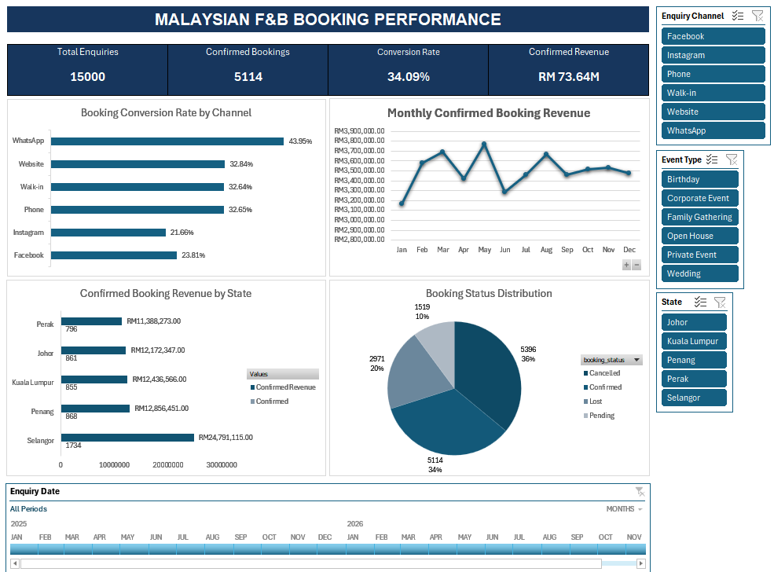
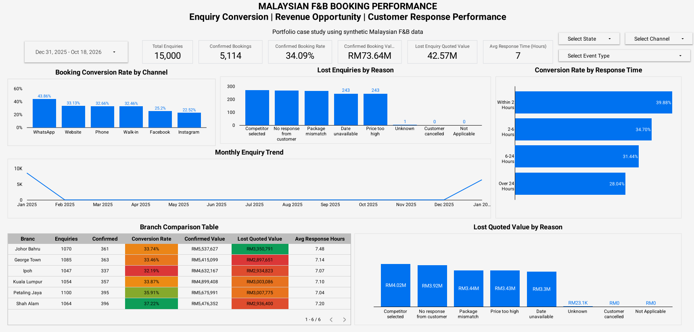

# Malaysian F&B Booking Conversion Analysis

## Project Overview

An end-to-end Data Analyst portfolio project exploring enquiry conversion, confirmed booking value and customer response performance in the Malaysian food and beverage (F&B) industry.

The project uses **15,000 synthetic customer enquiries** and demonstrates data cleaning, exploratory data analysis, KPI reporting, dashboard development and business recommendations.

**Tools:** Microsoft Excel, Power Query, PivotTables, Google Looker Studio

> **Data disclosure:** This project uses fictional, synthetic data for educational purposes. Results do not represent an actual Malaysian F&B business.

## Business Problem

An F&B catering and events company receives enquiries through WhatsApp, Instagram, Facebook, its website and other channels. Not all enquiries become confirmed bookings.

The analysis addresses the following questions:

- What percentage of enquiries become confirmed bookings?
- Which enquiry channels have the highest conversion rates?
- What quoted value is associated with lost enquiries?
- Why do enquiries fail to convert?
- How do response times and branch performance vary?

## Dataset

| Attribute | Details |
|---|---|
| Cleaned records | 15,000 enquiries |
| Original records | 15,035 rows |
| Geography | Malaysia |
| Dataset type | Synthetic |
| Key fields | Enquiry date, state, branch, channel, booking status, quoted amount, response hours and confirmed revenue |

## Data Cleaning

Using Excel Power Query, I:

1. Removed duplicate enquiry IDs.
2. Standardized enquiry channel names.
3. Corrected data types.
4. Reviewed missing response-time values.
5. Created booking flags, month fields and response-time categories.
6. Validated the cleaned dataset against the original records.

## Key Performance Indicators

| KPI | Result |
|---|---:|
| Total enquiries | 15,000 |
| Confirmed bookings | 5,114 |
| Confirmed booking rate | 34.09% |
| Confirmed booking value | RM 73,644,752 |
| Lost enquiries | 2,971 |
| Lost enquiry quoted value | RM 42,568,914 |
| Average recorded response time | Approximately 7.16 hours |

*Confirmed booking value is not necessarily cash collected. Lost enquiry quoted value is not guaranteed recoverable revenue.*

## Dashboard Preview

### Excel Dashboard

### Looker Studio Dashboard

**Interactive dashboard:** [View Looker Studio Report](httpsdatastudio.google.comreporting4be5429a-58b8-4b8d-bf1d-d3c13e0c24ae)

## Key Findings

### 1. Channel Performance

WhatsApp achieved a 43.95% booking conversion rate, compared with 21.66% for Instagram.

### 2. Lost Enquiry Opportunity

A total of 2,971 enquiries were classified as Lost, representing approximately RM 42.57 million in quoted value.

### 3. Response Time

The average recorded response time was approximately 7.16 hours. Additional analysis is needed to determine how response time relates to booking conversion.

### 4. Branch Performance

[Insert your verified finding from the Branch_Analysis worksheet.]

### 5. Lost Reasons

[Insert the most common lost reason and the highest-value lost reason from your analysis.]

## Business Recommendations

1. Investigate channel-level differences and test structured enquiry follow-up.
2. Prioritize preventable lost reasons associated with high quoted value.
3. Pilot response-time targets and measure their impact.
4. Review branch-level performance using consistent KPIs.

## Project Files

- `data/raw/` — Original synthetic dataset
- `data/cleaned/` — Cleaned dataset
- `excel/` — Excel analysis workbook
- `screenshots/` — Dashboard images
- `reports/` — Executive summary
- `dashboard/` — Looker Studio report link

## How to Explore the Project

1. Download the cleaned CSV from `data/cleaned/`.
2. Open the Excel workbook in `excel/`.
3. Review the KPI, PivotTable and dashboard worksheets.
4. Open the Looker Studio report using the link above.
5. Read the executive summary in `reports/`.

## Limitations

- Data is synthetic and not representative of real Malaysian F&B market performance.
- Quoted booking values do not measure profit or cash received.
- Observed differences in conversion rates do not establish causation.
- Recommendations require validation using real operational data.
